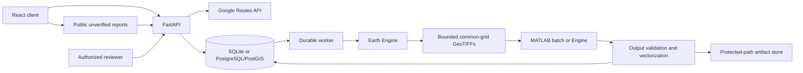

# Architecture

## Boundaries

The browser sends location strings and configuration bounds. Only the backend calls Routes with the private server key. Route geometry is validated and persisted; analysis creation takes a UUID referring to that provider response, never an arbitrary file path or MATLAB command.

Metric buffering and chainage use a route-centered azimuthal equidistant CRS. Routes are restricted to Northeast India (88–98°E, 24–30°N) and 400 km. Ordered 2 km sections use local UTM grids at 10 m, with configurable 50–1000 m analysis radius. A separate assumed 20 m road width is used for potential direct impact; the much wider analysis corridor includes slopes.

The worker claims persisted jobs using a row lock with `SKIP LOCKED` in PostgreSQL. SQLite development requires one worker. Each stage checks cancellation and heartbeats. Network calls have deadlines. Direct downloads retry up to three times and stop at 32 MiB. A global job timeout bounds the full run. MATLAB executes in a child process with fixed scripts; Engine is also isolated in a subprocess. Cancellation terminates the process tree on Windows. Interrupted jobs become failed after a five-minute heartbeat gap.

Exports use one grid per section. Python verifies CRS, shape, transform, band count, bounded size and valid pixels. MATLAB independently checks georeferencing, bands, no-data and units. It refuses misaligned grids rather than automatically registering images. Python validates MATLAB outputs, vectorizes the real binary change mask, transforms polygons to WGS84 and computes route distances/overlap in metric coordinates.

## Data model

| Table | Purpose |
|---|---|
| users, sessions | Local password-hashed users and expiring opaque session tokens |
| routes, segments | Provider geometry, corridor, chainage, local EPSG and distance/time |
| jobs | Durable request, state, progress, errors, timestamps and result manifest |
| scenes | Collection, scene ID, actual acquisition, orbit, units, coverage and export grid |
| candidates | WGS84 polygons, spatial metrics, segment/job provenance and limitations |
| incidents | Observation time separate from submission time; location, type, moderation and lifecycle |
| evidence | Append-only verification decisions, sources, notes, expiry and closure assertions |
| audit | Actor, action, target, timestamp and decision payload |

Alembic migration `0001` creates the schema. PostgreSQL adds PostGIS spatial expression indexes over route GeoJSON and incident points; SQLite retains validated GeoJSON and Python geometry operations. ORM definitions are the initial migration's schema source; freeze them before introducing later migrations.

## Evidence rules

Status is evaluated per section and refreshed on result retrieval. Current authorized closure takes priority, followed by recent unverified blockage reports. Imagery candidates are shown only within their freshness/coverage qualification. Latest review supersedes previous review. Resolved/rejected incidents do not corroborate an active closure. Conflicting imagery and official closure remain visible; no candidate never overrules a closure.

Image freshness uses the newest SAR acquisition, with the earlier baseline and all optical dates displayed separately. The default stale threshold is 14 days, configurable. This threshold is an application convention, not a validated road-safety criterion.

## Security and deployment

Password scrypt hashes and SHA-256 session-token hashes are stored server-side. Cookies are HTTP-only, SameSite Strict, expire after eight hours and can require HTTPS. State-changing requests require the application header and an allowed Origin. Roles are enforced in API dependencies. Secrets never appear in integration-status responses. Provider errors are translated to safe error codes.

Photographs are size/type/pixel validated, re-encoded as JPEG to remove metadata and available only to reviewers. Public narrative and coordinates are public by design. The offline queue stores incident text only; no automatic photo uploads. Last-known result metadata is labeled cached. Service worker caching excludes every API response.

The in-memory rate limiter is for a single API instance. Production needs an upstream shared limiter, HTTPS, resource quotas, security review, monitoring, backups and a retention policy. Database roles are application roles; account creation does not establish real-world agency authority.
